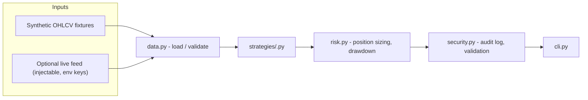

# Architecture

## Data flow

## Asset classes
- BTC: SMA crossover trend
- ETH: ROC momentum + volume
- Alts: Bollinger-style mean reversion
- Stables: Spread monitoring

## Security layers
See docs/security-architecture.md
